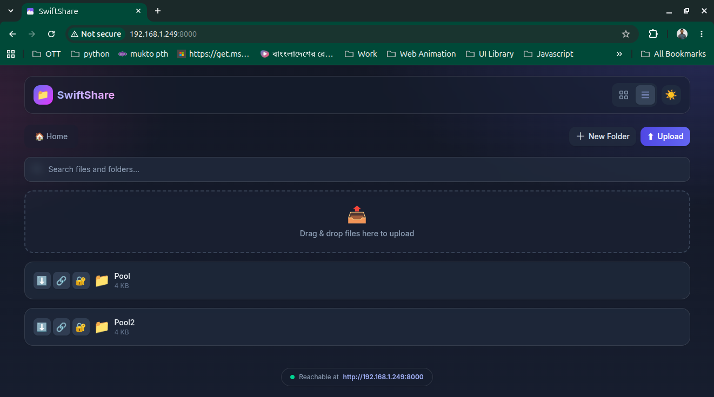
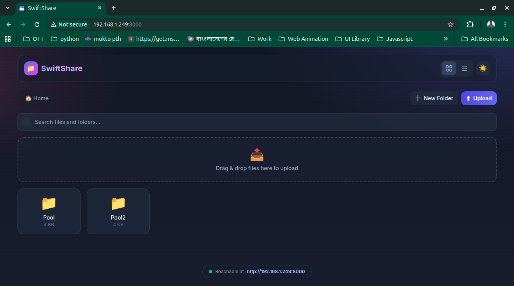
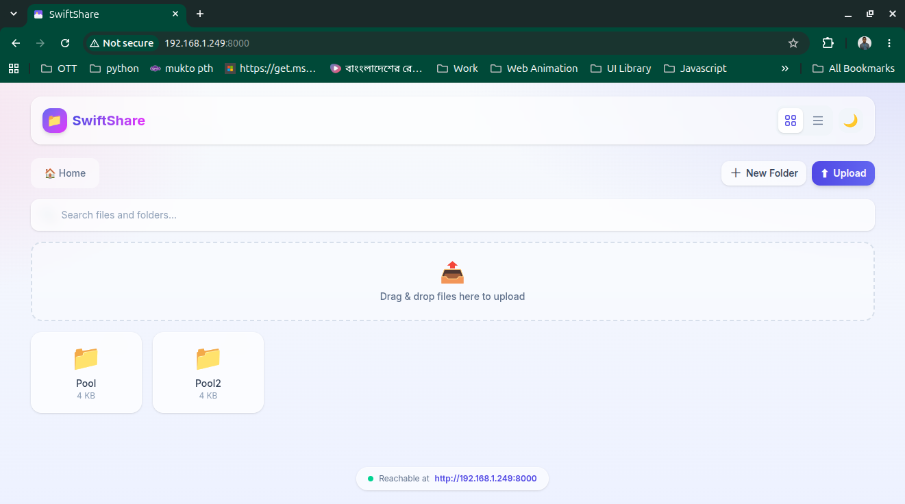

# SwiftShare

A beautiful, easy-to-use local-network file-sharing web app. Run it on any machine
and browse, upload, download, preview, and share files from any device on the same
network — phone, tablet, or laptop.


---

## Features

- **File browser** — browse directories and files with breadcrumb navigation, grid/list views, and file-type icons.
- **Drag & drop upload** — drop files anywhere on the page to upload them to the current folder.
- **Download** — download individual files, or entire folders as a ZIP archive.
- **Create / delete** — make new folders with a modal form, or delete files or folders from the UI.
- **Preview** — inline preview for images, video, audio, and PDFs, plus text-file preview.
- **Sharing** — generate shareable links for any file with optional expiry and password protection, and track download counts.
- **Search** — live filter of the current folder by name.
- **Live transfer progress** — real-time progress bar for both uploads and downloads via Socket.IO, showing percentage and transferred size.
- **Dark / light theme** — toggle in the header; preference is remembered.
- **Local-network friendly** — auto-detects the machine's LAN IP, shows the connection URL, and serves a QR code for quick mobile pairing (see `/api/ip`).
- **Modern UI** — clean, responsive design with toast notifications, progress feedback, and smooth animations.
- **Large file support** — chunked Socket.IO uploads and streaming HTTP downloads with stable progress for large videos and folders, up to 100 GB.
- **Resumable downloads** — HTTP `Range` request support for pause/resume and seeking.
- **Pagination & caching** — directory listings paginated (200 items/page) with ETag/304 support and in-memory directory cache.
- **WebSocket streaming** — Socket.IO heartbeat, rooms, and chunked WebSocket upload/download endpoints.
- **Multi-select** — Ctrl/Cmd+click to select multiple files; Delete key to remove selected items.
- **QR code pairing** — scan a QR code from the header to open SwiftShare on your phone instantly.
- **Skeleton loading** — placeholder states while directories load; debounced search (300ms).
- **Confirm dialogs** — modal confirmations for destructive actions instead of native `confirm()`.
- **Keyboard shortcuts** — `Ctrl/Cmd+F` to focus search, `Escape` to close modals, `Delete` to remove selected items.
- **Accessibility** — ARIA labels, `tabindex` on file items, `role="alert"` toasts, reduced-motion support.
- **Security headers** — `X-Content-Type-Options`, `X-Frame-Options`, `Referrer-Policy`; path-traversal protection; request-ID tracing.
- **Production server** — `uvloop` + `httptools`, GZip compression, configurable backlog/keep-alive/concurrency limits.

## Screenshots

<div align="center">
  
  <p><em>File browser with grid view, breadcrumb navigation, and drag-and-drop upload.</em></p>
  
  <p><em>Dark mode with glassmorphism header and redesigned cards.</em></p>
  
  <p><em>Share dialog with expiry and password protection.</em></p>
</div>

## Usage

- **Browse** — The `shared/` folder is your home directory. Click a folder to open it, or use the breadcrumb (🏠 Home) to jump back. Switch between **grid** and **list** views with the header toggle.
- **Upload** — Click **Upload**, or drag & drop files anywhere onto the drop zone. A floating progress bar appears at the bottom showing the file name, percentage, and bytes transferred.
- **Download** — Click the ⬇️ action on a file (or on a folder to get a ZIP archive). Downloads also show a live progress bar as bytes are received.
- **New folder / delete** — Use **New Folder** in the toolbar, or right-click an item for the context menu (preview, download, share, delete).
- **Share** — Click 🔐 on an item, set an expiry (hours) and an optional password, then copy the generated link.
- **Search** — Type in the search box to instantly filter the current folder by name.
- **Theme** — Toggle light/dark with the 🌙 button; your choice is saved in the browser.

> Uploads use Socket.IO for real-time progress and chunked delivery. Downloads are streamed over HTTP with Socket.IO progress events, so the browser can save large files directly to disk without loading them entirely into memory.

## How it works

- The web app (HTML/CSS/JS in `static/`) is served from the **project source folder**.
- The **`shared/`** folder is the home directory shown in the file browser. Only files
  and folders inside `shared/` are listed, uploaded, downloaded, or previewed — path
  traversal outside of it is blocked for security.

```
Portable_File_Transfer/        <- project source (serves the web app)
├── shared/                    <- home directory for the file browser
├── src/swiftshare/            <- FastAPI backend
├── static/                    <- frontend (index.html, css, js)
├── tests/
├── pyproject.toml
└── README.md
```

## Quick start

Requires **Python 3.11+**, [`uv`](https://docs.astral.sh/uv/), and [`bun`](https://bun.sh).

One-liner to get running:

```bash
uv sync && cd frontend && bun install && bun run build && cd .. && uv run uvicorn src.swiftshare.main:app --host 0.0.0.0 --port 8001
```

Or step by step:

```bash
# 1. Install backend dependencies
uv sync

# 2. Install frontend deps and build assets into ../static/
cd frontend
bun install
bun run build
cd ..

# 3. Start the server
uv run uvicorn src.swiftshare.main:app --host 0.0.0.0 --port 8001
```

Then open one of:

- `http://localhost:8001` on the same machine
- `http://<your-lan-ip>:8001` from any device on the same network
  (the app shows this URL on the home screen, fetched from `/api/ip`)

> Port 8000 is the default. If it's already in use by another process, pick a different port (e.g. `--port 8001`).

### Performance flags

| Flag                      | Default         | Description                                      |
|---------------------------|-----------------|--------------------------------------------------|
| `--workers`               | `1`             | Worker processes (keep 1 for Socket.IO rooms)    |
| `--threads`               | `cpu*4 + 1`     | Thread pool size for blocking file ops           |
| `--backlog`               | `2048`          | Socket listen backlog                            |
| `--limit-concurrency`     | `none`          | Max concurrent requests                          |
| `--limit-max-requests`    | `none`          | Max requests before worker restart               |
| `--timeout-keep-alive`    | `300`           | Keep-alive timeout in seconds                    |
| `--timeout-graceful-shutdown` | `600`      | Graceful shutdown timeout in seconds             |
| `--no-access-log`         | `false`         | Disable access log for better throughput         |
| `--log-level`             | `warning`       | Uvicorn log level                                |

`uvloop` and `httptools` are used by default for the event loop and HTTP parser.

### uv configuration

uv settings live in `pyproject.toml`:

```toml
[project]
name = "swiftshare"
requires-python = ">=3.11"
dependencies = [
    "aiofiles>=25.1.0",
    "fastapi>=0.141.1",
    "pydantic-settings>=2.15.0",
    "python-multipart>=0.0.32",
    "python-socketio>=5.10.0",
    "qrcode>=8.2",
    "uvicorn>=0.52.4",
    "uvloop>=0.21.0",
    "httptools>=0.4.0",
]

[project.scripts]
swiftshare = "swiftshare.__main__:main"

[project.optional-dependencies]
desktop = [
    "pywebview>=5.0",
]

[tool.uv]
package = true

[build-system]
requires = ["uv_build>=0.12.7,<0.13.0"]
build-backend = "uv_build"
```

Install or update dependencies:

```bash
uv sync
```

Add a new dependency:

```bash
uv add <package>
```

Remove a dependency:

```bash
uv remove <package>
```


## Configuration

Settings can be overridden with environment variables (or a `.env` file):

| Variable               | Default            | Description                                   |
| ---------------------- | ------------------ | --------------------------------------------- |
| `SHARED_DIR`           | `./shared`         | Home directory shown in the file browser      |
| `PORT`                 | `8000`             | Server port                                   |
| `HOST`                 | `0.0.0.0`          | Bind address                                  |
| `MAX_UPLOAD_SIZE`      | `107374182400` (100GB) | Maximum upload size in bytes                  |
| `ENABLE_AUTH`          | `false`            | Enable basic auth (reserved for future use)   |
| `SHARE_EXPIRY_HOURS`   | `24`               | Default share link lifetime in hours          |

Example:

```bash
SHARED_DIR=/path/to/my/files PORT=8080 uv run uvicorn src.swiftshare.main:app --host 0.0.0.0 --port 8080
```

## Frontend (React + Vite + Tailwind CSS v4)

The UI is a React 19 SPA built with [Vite](https://vitejs.dev) and styled with [Tailwind CSS](https://tailwindcss.com) (v4). The frontend lives in `frontend/` and builds into `static/` so the FastAPI server serves it with no separate frontend server.

```bash
# 1. Install frontend dependencies (needs Bun)
cd frontend
bun install

# 2. Build the frontend (outputs to ../static/)
bun run build

# 3. Start the backend server
cd ..
uv run uvicorn src.swiftshare.main:app --host 0.0.0.0 --port 8001
```

Source files:
- `frontend/src/` — React components, types, hooks, and Tailwind source CSS
- `frontend/vite.config.ts` — Vite config (builds to `../static/`)
- `frontend/postcss.config.js` — Tailwind CSS PostCSS plugin
- `static/index.html` — Vite-built HTML entry (served by FastAPI)
- `static/assets/` — compiled CSS and JS bundles (generated by `bun run build`)

### Frontend scripts

| Script                   | Description                                |
|--------------------------|--------------------------------------------|
| `bun run dev`            | Start Vite dev server (port 5173)          |
| `bun run build`          | Build production assets into `../static/`  |

## Project structure

```
Portable_File_Transfer/
├── AGENTS.md
├── pyproject.toml
├── README.md
├── uv.lock
├── frontend/                 # React 19 + Vite + Tailwind CSS v4
│   ├── index.html            # Vite HTML entry
│   ├── vite.config.ts        # Vite config (builds to ../static/)
│   ├── postcss.config.js     # Tailwind CSS PostCSS plugin
│   ├── package.json
│   ├── bun.lockb
│   ├── tsconfig.json
│   └── src/
│       ├── main.tsx          # React entry point
│       ├── index.css         # Tailwind CSS source
│       ├── App.tsx           # Root component
│       ├── lib/utils.ts      # Format helpers, file icons
│       ├── types.ts          # TypeScript types
│       └── components/       # React components
│           ├── Header.tsx
│           ├── Toolbar.tsx
│           ├── StatsBar.tsx
│           ├── Breadcrumb.tsx
│           ├── FileBrowser.tsx
│           ├── FileItem.tsx
│           ├── TransferPanel.tsx
│           ├── ToastContainer.tsx
│           ├── QRModal.tsx
│           ├── NewFolderModal.tsx
│           ├── ShareModal.tsx
│           ├── PreviewModal.tsx
│           ├── ConfirmModal.tsx
│           └── ContextMenu.tsx
├── src/swiftshare/          # FastAPI backend
│   ├── __main__.py       # CLI entrypoint
│   ├── main.py            # FastAPI app, static serving, /api/ip
│   ├── config.py          # Configuration (pydantic-settings)
│   ├── models.py          # Pydantic models
│   ├── file_manager.py    # File operations (browse/upload/download/delete)
│   ├── share_manager.py   # Share-link logic (expiry, passwords, counts)
│   ├── socketio_server.py # Socket.IO transfer events
│   └── routers/
│       ├── files.py       # File API routes
│       ├── upload.py      # Upload API route
│       └── shares.py      # Share API routes
├── static/                  # Served by FastAPI (built by frontend)
│   ├── index.html          # Vite-built HTML entry
│   └── assets/            # Compiled CSS and JS bundles
├── shared/                  # Home directory for the file browser
└── tests/test_api.py
```

## API overview

All file operations are rooted at the `shared/` directory.

| Method | Endpoint                       | Description                          |
| ------ | ------------------------------ | ------------------------------------ |
| GET    | `/api/files/?path=`            | List a directory                     |
| GET    | `/api/files/info?path=`        | Get metadata for a file/folder       |
| POST   | `/api/files/mkdir`             | Create a folder (`{path, name}`)     |
| DELETE | `/api/files/?path=`            | Delete a file/folder                 |
| GET    | `/api/files/download?path=`    | Download a file                      |
| GET    | `/api/files/download-folder`   | Download a folder as ZIP             |
| GET    | `/api/files/preview?path=`     | Read text preview                    |
| GET    | `/api/files/mime-type?path=`   | Get MIME type                        |
| POST   | `/api/upload/`                 | Upload file(s) (multipart form)      |
| POST   | `/api/upload/chunk`            | Resumable chunked upload             |
| POST   | `/api/shares/`                 | Create a share link                  |
| GET    | `/api/shares/`                 | List active shares                   |
| GET    | `/api/shares/{id}`             | Resolve a share (optional `password`)|
| DELETE | `/api/shares/{id}`             | Delete a share                       |
| GET    | `/api/ip`                      | LAN IP + port for mobile pairing     |
| GET    | `/api/health`                  | Server health + uptime               |

Socket.IO is mounted at `/socket.io` and is used for real-time transfer progress and chunked file transfers.

### WebSocket events (Socket.IO)

| Event                  | Direction | Payload                                      |
|------------------------|-----------|----------------------------------------------|
| `connect` / `disconnect` | both   | connection lifecycle                         |
| `join_room` / `leave_room` | client | `{ room: "transfers" \| "files" }`          |
| `ping` / `pong`        | both      | heartbeat                                    |
| `transfer:started`     | server    | `{ transfer_id, filename, total, percent }`  |
| `transfer:progress`    | server    | `{ transfer_id, loaded, total, percent }`    |
| `transfer:completed`   | server    | `{ transfer_id, filename, percent }`         |
| `transfer:error`       | server    | `{ transfer_id, error }`                     |
| `upload:progress`      | server    | `{ transfer_id, filename, chunk_index, progress }` |
| `upload:complete`      | server    | `{ transfer_id, filename, path, size }`      |
| `upload:error`         | server    | `{ transfer_id, error }`                     |
| `download:chunk`       | server    | `{ transfer_id, chunk_index, filename, size, data }` |
| `download:complete`    | server    | `{ transfer_id }`                            |
| `download:error`       | server    | `{ transfer_id, error }`                     |
| `file:changed`         | server    | `{ action, path, item, timestamp }`          |

## Development

### Backend

```bash
# Run with auto-reload
uv run uvicorn src.swiftshare.main:app --reload --host 0.0.0.0 --port 8000

# Run via CLI entrypoint (recommended for production)
uv run swiftshare --host 0.0.0.0 --port 8000

# Run the test suite
uv run pytest
```

### Frontend

```bash
cd frontend

# Install dependencies (first time only)
bun install

# Start Vite dev server (proxies API to :8001)
bun run dev

# Build production assets into ../static/
bun run build

cd ..
```

## Security notes

- The server binds to `0.0.0.0` by design so other devices on your LAN can connect.
  Only run it on trusted networks, or firewall the port, since there is no authentication by default.
- All file paths are resolved and confined to `shared_dir`; attempts to escape it are rejected.
- Share passwords are stored as SHA-256 hashes; share state is in-memory and resets on restart.

## License

MIT
